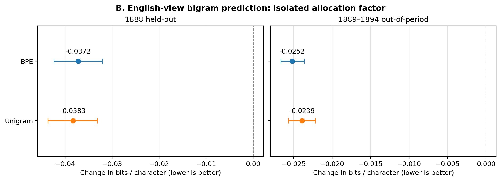

# Sampling historical isiXhosa newspaper text for NLP

We tested how the way a historical newspaper corpus is sampled changes the tokenizers trained on it. The text comes from *Imvo Zabantsundu* in the isiXhosa Intellectual Traditions (IsiXIT) collection.

The experiment changes two choices: how much text to take from the archive's English and isiXhosa views, and how to sample pages within each view. We held the training-text budget nearly constant.

## What we did

We compared four sampling policies (PP, PW, WP, WW), two SentencePiece models (BPE and Unigram), and five seeds. That produced 40 main tokenizers, each trained on roughly 500,000 alphabetic characters. We trained 20 more BPE models to check whether repeated newspaper text explained the effects.

Training used 1885 and January to September 1887. We selected smoothing on October to December 1887, evaluated on 1888, then checked 1889 to 1894.

## Main results

| Effect of changing allocation in 1888 | Difference | 95% issue-bootstrap interval |
| --- | ---: | ---: |
| English-view BPE pieces per 100 letters | -1.88 | [-1.97, -1.78] |
| English-view Unigram pieces per 100 letters | -1.79 | [-1.91, -1.67] |
| isiXhosa-view BPE pieces per 100 letters | +0.45 | [+0.41, +0.50] |
| English-view bigram bits per character | -0.0372 | [-0.0424, -0.0321] |

Lower values are better. The English-view improvement comes with a segmentation cost in the isiXhosa view. Changing the **entire** policy was not always better: it slightly worsened English-view bigram loss in the later years (+0.0045 BPC). See [findings](reports/findings.md) for the controls and limitations.



## Run it

Install Python 3.13 and the pinned packages:

```bash
python -m pip install -r requirements.txt
python src/run.py check
```

The check verifies the saved models and recalculates all 64 factorial effects from the original paired scores. It does not retrain models.

**Full fresh reproduction (26 October 2026):** the complete Phase 2–6 pipeline was independently replayed using the pinned original source-data ZIP and the byte-verified repository scripts. All 60 regenerated SentencePiece models match after normalising path-only serialization fields; the held-out scores and published contrasts match the original archive byte-for-byte, and all seven scientific audit checks passed. See the [reproduction report](reports/fresh_reproduction_2026-10-26.md) and [certificate](results/fresh_reproduction_2026-10-26.json). This replay ran in a separate isolated compute environment, **not GitHub Actions**; the original input was provided directly to that environment. Dataset inclusion in the repository is separate from CI's saved-output checks.

To rerun the original experiments, use the verified `data/TxtLangFiles1870-1894_TB.zip` if present, or copy the authorised course-provided archive into `data/` first, then run:

```bash
python src/run.py reproduce --data data/TxtLangFiles1870-1894_TB.zip --out ../isixhosa-replay
```

Use `--dry-run` to preview the commands, or `--resume` after interruption.

## Files

| Folder | Contents |
| --- | --- |
| `src/` | Original Python experiments, runner and checks |
| `results/` | CSV comparisons, raw scores, trained models and figures |
| `reports/` | Methods, findings and frozen protocols |
| `data/` | External source data, not committed |

The original training script is in [src/phase2](src/phase2/). The key numeric tables are [segmentation](results/segmentation.csv), [bigram](results/bigram.csv) and [repetition controls](results/repetition.csv).

This study uses one newspaper. The archive's language views are not gold-standard labels, and the later years had already been inspected during earlier exploration. These results concern corpus sampling, not cultural understanding or social fairness. Details are in [methods](reports/methods.md).

Archive: [Schoots et al. (2023)](https://aclanthology.org/2023.rail-1.7/). Tokenization: [Kudo and Richardson (2018)](https://aclanthology.org/D18-2012/).

**Independent scientific audit (26 October 2026):** a separate implementation rechecked all **84** published contrasts and confidence intervals, all **249,300** individual tokenizer/count-bigram/repetition predictions, the frozen F1–F6 gates and dataset/split/overlap diagnostics. See the [full scientific audit](reports/independent_scientific_audit_2026-10-26.md) and [verification certificate](results/independent_audit_2026-10-26.json). The dataset-free [independent checker](src/audit/independent_ci.py) now runs on every GitHub CI push/PR; the full original-data and model-level checks were performed separately in an isolated local environment. The original course-provided ZIP archives are now tracked under [data/](data/); verify their checksums and applicable redistribution conditions.

**Additional exploratory analysis (26 October 2026):** the [paired-metric and issue/length audit](reports/exploratory_metric_relationships_2026-10-26.md) re-examines existing held-out scores without retraining. On BPE isiXhosa-view 1888 material, segmentation gets less compact in 50/52 issues while BPC improves in 31/52, with 29/52 opposite-sign issue effects. English-view BPE improves in segmentation across all 52 issues, and the allocation trade-off persists across all four excerpt-length quartiles in both views. These post-hoc diagnostics are **not independent replication or proof of cultural harm**. The [source script](src/analysis/metric_relationships.py), [issue-level evidence](results/exploratory/), and [metric](results/figures/metric_coupling_1888.png) / [length](results/figures/length_quartiles_1888.png) figures are tracked. Run `python src/analysis/metric_relationships.py --root . --verify` to reproduce the reported CSV artifacts without fitting models.

Earlier experiments and the separate historical inference programme are indexed in [research history](reports/research_history.md). They are supporting research, not extra tests of the main coursework result.
