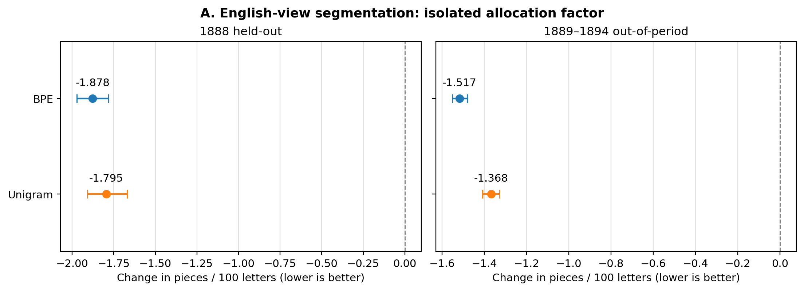

# Sampling and representation in a historical isiXhosa archive

**Reproducible experiments for NLP Project 2 (2026)**

> **Release status, 25 October 2026:** Reviewer documentation is published here. Source code, saved models, numerical artifacts, and plots remain in the [prepared full public-release ZIP](docs/PUBLISHING.md) and are not yet fully mirrored to GitHub. Links into `coursework/` and `supplementary/` will work after the full-source import. The main numerical claims were verified against the saved files locally, not reproduced from this GitHub checkout yet.

Digitised newspapers are not neutral datasets. A researcher can choose which pages to sample, how to weight text categories, and how much repeated material to retain. Those choices can change which language views a tokenizer represents efficiently and how a simple language model scores unseen text.

This repository documents those choices using the *Imvo Zabantsundu* texts in the isiXhosa Intellectual Traditions (IsiXIT) archive. The main study is a controlled 2 by 2 sampling experiment, rather than a new tokenizer algorithm. We include the full research scripts, trained models, matched evaluation outputs, preregistered protocols, falsification tests and negative results.

## The question

When the amount of training text is held approximately fixed, how much do two dataset construction decisions matter?

1. **View allocation:** how much text is allocated to the archive's English and isiXhosa views.
2. **Within-view selection:** whether pages or individual words determine which material is selected inside each view.

The four conditions are `PP`, `PW`, `WP` and `WW`. Each letter indicates page-weighted (`P`) or word-weighted (`W`) selection along one factor. The original Phase 1 protocol is the authority for implementation details. We separate individual factor effects from the full `WW` versus `PP` policy contrast.

## What we found

The principal result is a representation trade-off. Giving more weight to the English view improves its subword compactness under both BPE and Unigram, but can worsen isiXhosa-view compactness. In the tested count-bigram language model, the isolated English allocation intervention also improves English-view held-out bits per character (BPC).

| Held-out 1888 comparison | Estimate | 95% issue-bootstrap interval |
| --- | ---: | ---: |
| BPE English-view allocation effect, pieces per 100 characters | -1.8775 | [-1.9716, -1.7818] |
| Unigram English-view allocation effect, pieces per 100 characters | -1.7948 | [-1.9081, -1.6706] |
| BPE isiXhosa-view allocation effect, pieces per 100 characters | +0.4526 | [+0.4068, +0.4974] |
| BPE English-view allocation effect, BPC | -0.03722 | [-0.04236, -0.03212] |

The BPC result is about **1.29%** relative to the `PP` English-view reference mean. This is a modest intrinsic modelling effect, not proof of improved semantic understanding.

**A result that did not hold:** switching the *entire* sampling policy from `PP` to `WW` is not consistently better on later years. For BPE, the later-year English-view `WW - PP` BPC contrast was **+0.00450**, indicating slightly worse BPC under `WW`. Reporting only the favourable isolated allocation effect would misrepresent the experiment.



The full results, including the trade-off and counterexample, are in [Findings](docs/FINDINGS.md). The effect plots were regenerated from verified underlying outputs, not manually sketched.

## Study design

| Component | Design |
| --- | --- |
| Text | Historical *Imvo Zabantsundu*, archive-assigned `EnTxt` and `XhTxt` blocks |
| Model fits | 2 tokenizer families x 4 policies x 5 seeds = 40 tokenizers |
| Tokenizers | SentencePiece BPE and Unigram, vocabulary size 2,000 |
| Equalised exposure | About 500,000 alphabetic letters per training condition |
| Training | 1885 and January to September 1887 |
| Validation | October to December 1887 with duplicate-aware windows |
| Held-out evaluation | 1888 and a later 1889 to 1894 within-newspaper period |
| Prediction model | Smoothed count-bigram language model; validation-selected alpha = 100 from {1, 10, 100} |
| Robustness | Matched-support repeated-text filtering, 20 additional BPE fits |
| Uncertainty | Publication-issue bootstrap, conditional on this historical collection |

We analysed **2,493 paired page/view excerpts from 358 issues** and saved 99,720 paired evaluation rows. The record also includes precommits, decisions, and procedures that did not support the original direction. [Methods and validity](docs/METHODS_AND_VALIDITY.md) gives the necessary qualifications.

## Reproduce the results

**Python 3.13** and the separately obtained **original** `TxtLangFiles1870-1894_TB.zip` are required. The source archive is not republished here because redistribution permission has not been established.

```bash
python -m pip install -r requirements.txt
sh coursework/isiXhosa_Excellence_Sprint/Phase6/submission_code/RUN_FAST_CHECK.sh /path/to/TxtLangFiles1870-1894_TB.zip
```

A successful fast check reports `PASS 7 independent scientific tests` and recreates the four Phase 6 figures. This validates saved results. It does not retrain every model. [Reproducibility guide](docs/REPRODUCIBILITY.md) gives the longer training and replay commands.

## Find your way around

- [`coursework/isiXhosa_Excellence_Sprint/`](coursework/isiXhosa_Excellence_Sprint): complete six-phase coursework implementation, models, source-to-score scripts, raw numeric results and scientific audit.
- [`docs/FINDINGS.md`](docs/FINDINGS.md): main results, counterexamples and conditional uncertainty.
- [`docs/REVIEWER_GUIDE.md`](docs/REVIEWER_GUIDE.md): short independent-review checklist and reproducibility routes.
- [`docs/DATA_ACCESS_AND_ETHICS.md`](docs/DATA_ACCESS_AND_ETHICS.md): source provenance, redistribution boundary and responsible interpretation.
- [`supplementary/`](supplementary/README.md): source scripts and selected reports from earlier exploratory research and a separate historical-inference programme. These are not additional independent replications of the main factorial study.

## What the evidence does not establish

The archive views are **not manually verified language labels**. The factorial comparison uses one newspaper, not two independent newspaper replications. The 1888 to 1894 texts had been examined in earlier exploratory work, so this is a controlled follow-up, not a never-examined external confirmation. Compactness and count-bigram likelihood do not measure fairness experienced by readers, cultural beliefs, semantic competence, or contemporary isiXhosa NLP outcomes.

This is a research and code repository, not the final coursework submission PDF. The course separately requires a two-page extended abstract, the official NeurIPS 2024 ethics questionnaire, the Faculty AI ethics declaration and a contribution statement. See [Submission status](docs/SUBMISSION_STATUS.md).

## References

- Schoots, J., Ngwendu, A., de Wet, J., and Muftic, S. (2023). *IsiXhosa Intellectual Traditions Digital Archive: Digitizing isiXhosa texts from 1870-1914*. [ACL Anthology](https://aclanthology.org/2023.rail-1.7/).
- Kudo, T., and Richardson, J. (2018). *SentencePiece: A simple and language independent subword tokenizer and detokenizer for neural text processing*. [ACL Anthology](https://aclanthology.org/D18-2012/).
- For additional background and manuscript references, see [`CITATIONS_FOR_MANUSCRIPT.bib`](coursework/isiXhosa_Excellence_Sprint/Phase6/CITATIONS_FOR_MANUSCRIPT.bib).

No software licence has been assigned to this public-release draft. Reuse permissions should be agreed by the actual contributors before adding a licence file.