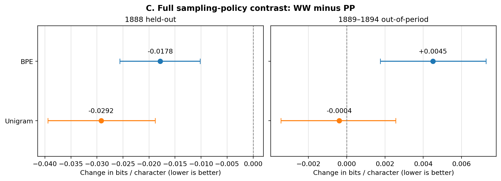

# Findings and negative results

The reported estimands and intervals below are taken from the frozen [Phase 6 claim ledger](../research-notes/Phase6/CLAIM_LEDGER.md) and independently reproduced numerical files. Contrast signs always follow the referenced phase definition.

## F1 to F4: sampling and representation

The 2 by 2 design isolates how much archive view allocation matters from how material is selected inside each view. Forty SentencePiece models cover BPE and Unigram, four policies and five sampling seeds. They received approximately equal numbers of alphabetic letters.

| Outcome | Isolated allocation contrast in 1888 | Conditional 95% issue-bootstrap interval |
| --- | ---: | ---: |
| English view, BPE pieces/100 chars | -1.8775 | [-1.9716, -1.7818] |
| English view, Unigram pieces/100 chars | -1.7948 | [-1.9081, -1.6706] |
| isiXhosa view, BPE pieces/100 chars | +0.4526 | [+0.4068, +0.4974] |
| isiXhosa view, Unigram pieces/100 chars | +0.5549 | See frozen Phase 3 outputs |

This supports an allocation-related representation trade-off. It is not a difference between manually labelled languages. The categories come from the archival split pipeline.

## F5: intrinsic downstream modelling

The downstream metric is held-out **bits per alphabetic character** (BPC), computed with a smoothed count-bigram model. The smoothing candidate `alpha = 100` was selected on the 1887 validation split, among exactly `{1, 10, 100}`.

| Comparison | 1888 BPC effect | 1889 to 1894 BPC effect |
| --- | ---: | ---: |
| English-view BPE isolated allocation | -0.0372167 | -0.0251924 |
| Whole-policy BPE `WW - PP` | -0.01784 | **+0.00450** |

For the primary 1888 isolated allocation effect, the 95% conditional issue-bootstrap interval is `[-0.0423644, -0.0321188]`; the later interval is `[-0.0266522, -0.0236545]`. Its 1888 magnitude is roughly 1.29% of the reference PP English BPC. Five of five seeds showed the predicted sign.

The later-year **whole-policy counterexample matters**. A favourable isolated factor effect does not establish that all other changes bundled into word-based corpus construction will help. Selection inside the views matters too. The isiXhosa-view BPE and Unigram BPC contrasts also need not track segmentation compactness in identical ways.

## F6: repeated-text falsification

The repeated-text control fitted twenty extra BPE models on filtered and unfiltered sets with matched surviving support. The filtering removed exact repeated 13-word sequences found across training and test issues under the study protocol, but it cannot exclude every shorter or paraphrased repetition.

| Contrast | 1888 English-view result | Conditional interval |
| --- | ---: | ---: |
| Duplicate-filtered `PP - WW` BPE, pieces/100 chars | +2.3891 | [+2.1824, +2.5898] |
| Matched-support unfiltered result | +2.0974 | Recorded in Phase 4 outputs |

The directional finding survived the tested exact-repeat control, which makes a trivial reprint explanation less plausible. It does **not** imply the historical text has no remaining duplication.

## How to interpret the confidence intervals

These are publication-issue bootstraps **conditional on the available Imvo collection, matched examples and trained seeds**. They do not make the historical newspapers or the chosen policy a random representative sample of every African-language archive. The later years had already been inspected in earlier research, so the study should be described as a controlled follow-up.

## What we did not find

- No general evidence that word-weighting the entire sampling policy always improves LM prediction.
- No evidence of shifts in historical political beliefs or a validated cultural sentiment label.
- No verified human-level fairness or downstream task accuracy result.
- No independent replication of this particular factorial experiment on Isigidimi.

For exact source figures and checks: [`Phase6/outputs`](../results/Phase6/outputs), [`Phase3/outputs`](../results/Phase3/outputs), [`Phase5/outputs`](../results/Phase5/outputs).